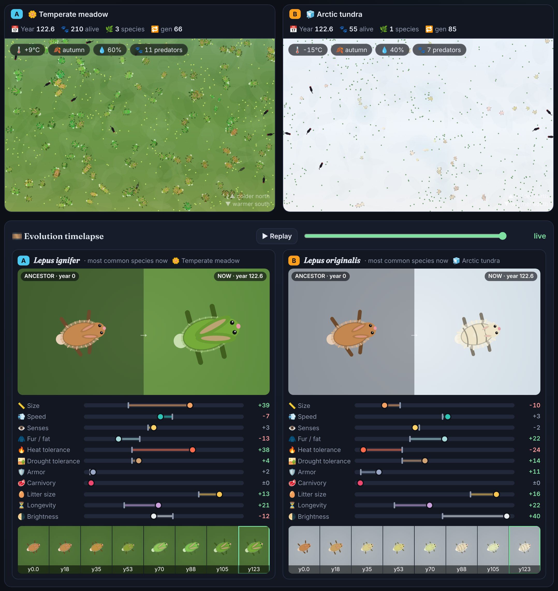

# 🧬 Primordia — an evolution sandbox

Pick a starting organism, shape its environment, press **Run** and watch a timelapse of how it evolves.
Turn on **⚖️ Compare** to run the same creatures in two different worlds side by side and see how the environment pushes evolution in different directions.



*Same rabbits, same random seed. After ~120 simulated years the meadow population turned green (camouflage on grass) and grew big ears, while the tundra population turned white, grew thick fur and lost its ears' heat-shedding role.*

## Features

- **8 starting organisms** — protocell, beetle, rabbit, lizard, frog, finch, grazer, wolf. Pick several to build a food chain.
- **Environment controls**: temperature, seasonal swing, humidity, plant growth, predators, oxygen, radiation (mutation rate), ground color. There are 8 biome presets, and every setting **changes live** while the simulation runs.
- **Procedural creatures**: each one is drawn from its genes. Fur grows with insulation, ears grow with heat tolerance, legs/wings with speed, plates and spikes with armor, fangs and hooked beaks with carnivory, eyes and antennae with senses, humps/scales with drought tolerance.
- **Evolution timelapse**: compares the ancestor with today's most common species, shows a filmstrip across time, and plots trait drift bars. You can scrub or **replay** the whole history.
- **Speciation and a family tree**: populations that split into genetically distinct groups become new species with generated Latin names (*Lepus lanatus*, *Coleops giganteus*…).
- **Charts**: population per species, temperature, and any trait over time, with event markers.
- **Journal**: a narrator explains what changed and why ("Fur ▲18% — thicker fur and fat to survive the cold").
- **Meddle**: ☄️ meteor strike, ❄️ ice age, 🔥 global warming, 🌵 drought, 🌸 super bloom, 🦠 plague (hits the commonest species hardest), 🐾 predator invasion.
- **Experiments**: one-click scenarios — Bergmann's rule, camouflage, giant Carboniferous insects, predator–prey arms race, desert vs jungle, life on Mars.
- **Inspect** any creature by clicking it. **Share** a link that recreates your exact setup (seeded and reproducible).

## How the model works (the short version)

Each creature has a genome of 12 numbers between 0 and 1. Every tick it pays an energy bill based on its genes and the environment:

| Pressure | Who benefits |
| --- | --- |
| Cold | Fur, big bodies (Bergmann's rule); cold-blooded animals slow down |
| Heat | Heat tolerance (big ears, sweat), less fur, smaller bodies |
| Dry air | Drought tolerance; amphibians suffer most; plants cluster around oases |
| Thin oxygen | Small bodies. **Rich oxygen** lets big bodies (and giant insects) thrive |
| Predators | Camouflage (matching the ground), speed (dodging), armor, large size |
| Scarce food | Efficient, cheaper bodies; sharper senses |
| Radiation | Faster mutation, which means more variation and more species |

Creatures eat plants (or other species, if they're carnivores), and well-fed adults reproduce asexually. Offspring inherit the genome with small mutations, so whoever fits the environment best leaves more offspring. Energy is conserved through the food chain: a hunter only gets back what its prey ate.

It's a toy model, simplified for fun rather than accuracy, but the classic patterns come out on their own.

## Run locally

No build step, just static files. ES modules need an HTTP server, so `file://` won't work:

```bash
python3 -m http.server 8000
```

Then open <http://localhost:8000>.

To balance-test the simulation without a browser:

```bash
node tools/headless.mjs 60 rabbit all 3
```

The arguments are years, organism(s), biome(s) or `all`, and the number of seeds. The script prints how many runs survived and the average trait change per biome.

## Deploy to GitHub Pages

The workflow `.github/workflows/pages.yml` runs a quick headless smoke test, then publishes the site on every push to `main`.

1. In the repository, go to **Settings → Pages → Build and deployment → Source** and choose **GitHub Actions**.
2. Merge or push to `main` (or run the workflow manually from the **Actions** tab).
3. The site appears at `https://<user>.github.io/evolution-simulator/`.

Alternatively, choose **Deploy from a branch** with `/ (root)`. It also works, because the site is plain static files (and there's a `.nojekyll`).

## Project layout

```
index.html          page shell
css/style.css       styling
js/sim.js           the evolution engine (pure logic, runs in Node too)
js/presets.js       genes, organisms, biomes, events, scenarios
js/render.js        procedural creature drawing and the world view
js/charts.js        line charts and the family tree
js/main.js          UI, main loop, timelapse, sharing
js/rng.js           seeded random numbers
tools/headless.mjs  command-line balance tester
```
